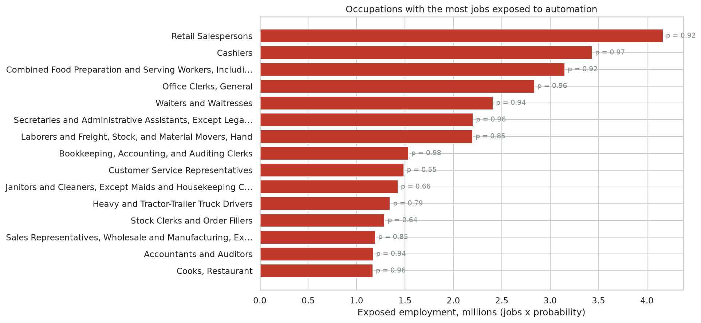
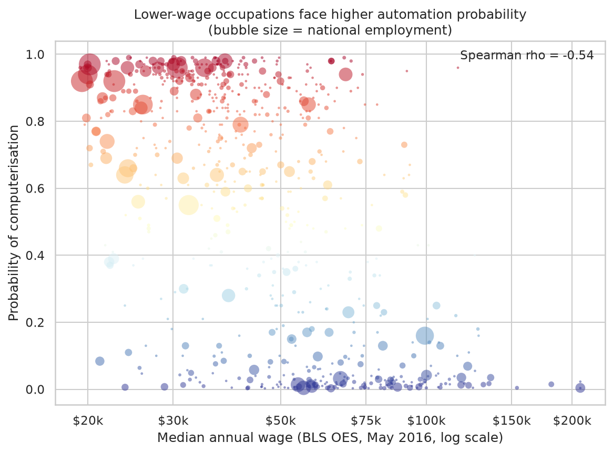
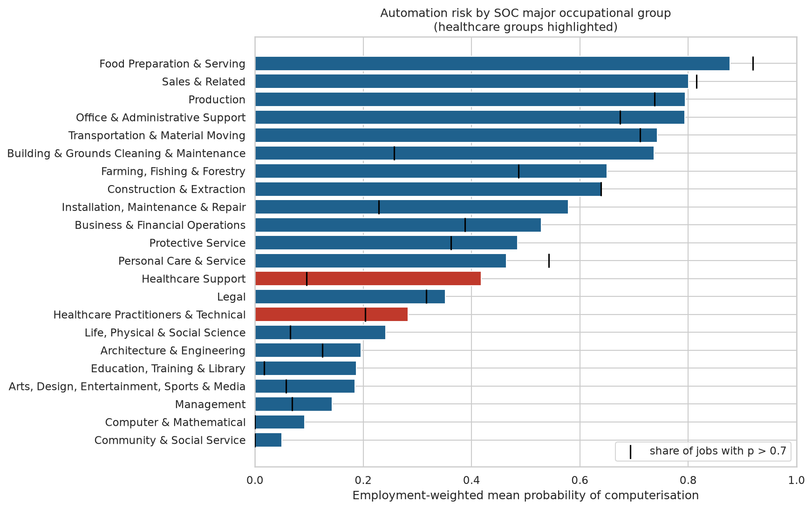
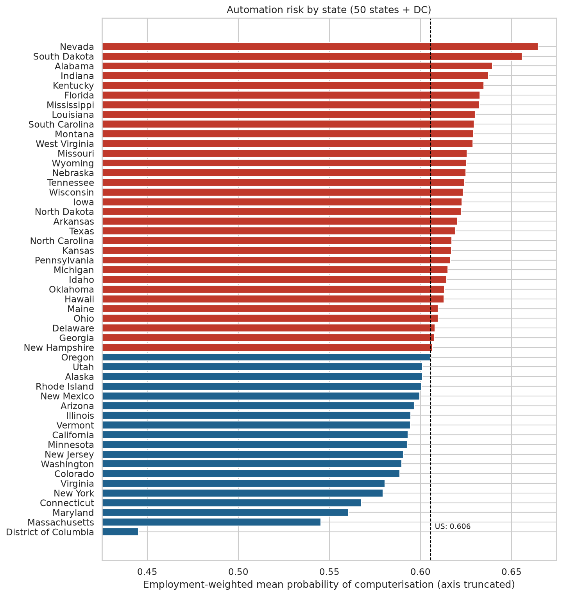
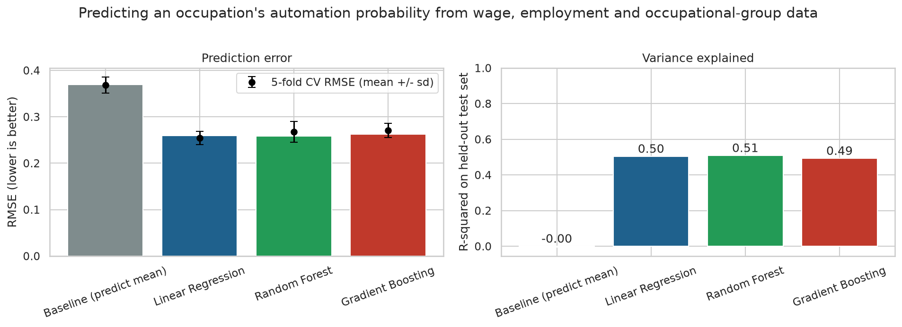
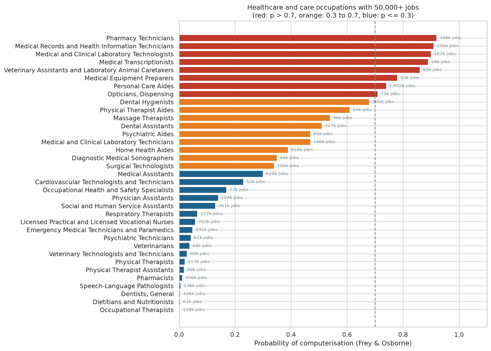

# Automation and AI Risk to US Jobs: occupations, occupational groups and states

A reproducible analysis of which US jobs, occupational groups and states are most exposed to automation, and whether machine learning can predict an occupation's automation risk from labour-market data. It combines Frey & Osborne's probabilities of computerisation with U.S. Bureau of Labor Statistics (BLS) employment and wage data for about 700 occupations.

The project is a cleaned, re-run and corrected version of the analysis in my MSc dissertation:

> Obidi, J. (2023). *Impact of Automation and Artificial Intelligence on Jobs in Developed Nations (US)*. MSc Data Analytics and Technology dissertation, University of Bolton.

The original methodology is kept (data sources, merge, exploratory analysis, four research questions, and a comparison of linear regression, random forest and gradient boosting). Errors found while re-running it are corrected and documented in [Corrections to the original analysis](#corrections-to-the-original-analysis).

**Author:** Jude Obidi · **Licence:** MIT (code) · **Main notebook:** [`notebooks/analysis.ipynb`](notebooks/analysis.ipynb)

---

## Research questions

1. Which jobs are most prone to automation?
2. How does automation risk vary across occupational groups?
3. Does automation risk differ between US states?
4. Can machine learning predict an occupation's automation risk, and which model performs best?

## Data

| Dataset | Content | Source |
|---|---|---|
| `automation_data_by_state.csv` | 702 occupations (SOC code), probability of computerisation, employment in each state and DC | Kaggle: [Occupation, Salary and Likelihood of Automation](https://www.kaggle.com/datasets/andrewmvd/occupation-salary-and-likelihood-of-automation) (Larxel / `andrewmvd`, 2020). Probabilities from Frey & Osborne (2017); state employment from BLS. |
| `occupation_salary.xlsx` | National employment, mean wages and wage percentiles by occupation | Same Kaggle dataset. Values match the [BLS Occupational Employment Statistics, May 2016 national estimates](https://www.bls.gov/oes/2016/may/oes_nat.htm). |

**The data files are not included in this repository.** The Kaggle dataset states that its licence "was not specified at the source", so redistribution rights are unclear. `python scripts/download_data.py` downloads them from Kaggle and verifies their checksums. See [`data/README.md`](data/README.md).

Credit: Frey, C. B. and Osborne, M. A. (2017). The future of employment: How susceptible are jobs to computerisation? *Technological Forecasting and Social Change*, 114, 254–280. [doi:10.1016/j.techfore.2016.08.019](https://doi.org/10.1016/j.techfore.2016.08.019). U.S. Bureau of Labor Statistics, Occupational Employment Statistics.

## Methods

1. **Merge.** Inner join of the two tables on the 6-digit SOC code (688 of 702 occupations match).
2. **Cleaning.** Thousands separators are removed. BLS `#` (wage at or above the $208,000 top-code) is set to the top-code, and `*` (not available) is treated as missing.
3. **Descriptive analysis (RQ1 to RQ3).** Occupation employment is the sum of the 51 state columns. Risk is summarised as the employment-weighted mean probability and as the share of jobs in "high-risk" occupations (probability > 0.7, the band used by Frey & Osborne). Occupational groups are the 22 SOC major groups.
4. **Modelling (RQ4).**
   * Target: the occupation's probability of computerisation.
   * Features: log employment, log annual wage distribution (mean and 10th, 25th, 50th, 75th and 90th percentiles), the relative standard errors of the employment and wage estimates, and the SOC major group. A second run drops the major group.
   * Models: linear regression, random forest and gradient boosting (as in the dissertation), plus a predict-the-mean baseline.
   * Protocol: 80/20 train/test split and `random_state = 42` as in the dissertation, 5-fold cross-validation on the training set, and preprocessing fitted inside a scikit-learn `Pipeline`.
   * The original 2023 pipeline is also re-run unchanged ([`src/automation_risk/replicate.py`](src/automation_risk/replicate.py)) to check that the dissertation's numbers reproduce.

## Key results

### RQ1: Jobs most prone to automation

Twelve occupations have the maximum probability of 0.99, including telemarketers, data entry keyers, insurance underwriters, tax preparers and new accounts clerks. The lowest-probability occupations (below 0.005) include recreational therapists, occupational therapists, audiologists, healthcare and mental-health social workers, and emergency management directors.

Weighting by employment, the occupations with the most jobs exposed are large, lower-wage occupations: retail salespersons (4.5 million jobs, p = 0.92), cashiers (3.5M, 0.97), combined food preparation and serving workers (3.4M, 0.92), general office clerks (3.0M, 0.96) and waiters and waitresses (2.6M, 0.94). Across all covered jobs the employment-weighted mean probability is **0.61**, and **51.7%** of jobs are in occupations with p > 0.7. Median wage and automation probability are negatively correlated (Spearman ρ = −0.54).




### RQ2: Variation across occupational groups

| SOC major group (selection) | Jobs covered | Employment-weighted mean p | Jobs with p > 0.7 |
|---|---:|---:|---:|
| Food Preparation & Serving | 12.9M | 0.877 | 91.9% |
| Sales & Related | 13.5M | 0.801 | 81.5% |
| Office & Administrative Support | 21.6M | 0.793 | 67.4% |
| Healthcare Support | 2.3M | 0.418 | 9.5% |
| Healthcare Practitioners & Technical* | 4.1M | 0.283 | 20.3% |
| Management | 6.9M | 0.143 | 6.9% |
| Computer & Mathematical | 2.7M | 0.092 | 0.0% |
| Community & Social Service | 1.8M | 0.050 | 0.0% |
| **All occupations** | **125.1M** | **0.606** | **51.7%** |

\*Excludes Registered Nurses, who have no employment counts in the source data. Adding them back with BLS national employment (2.86M, p = 0.009) lowers this group's figure to 0.171. Full table: [`results/rq2_major_groups.csv`](results/rq2_major_groups.csv).



### RQ3: Differences between states

The employment-weighted mean probability ranges from **0.545 (Massachusetts) to 0.665 (Nevada)** across the 50 states, with the District of Columbia lowest at 0.445. **California ranks 41st of 51 (0.593).** Because every occupation has the same probability in every state, these differences reflect each state's occupational mix. Large states still have the most workers in high-risk occupations: California about 7.2M, Texas 5.7M, Florida 4.0M and New York 3.9M. Full table: [`results/rq3_states.csv`](results/rq3_states.csv).



### RQ4: Predicting automation risk with machine learning

Corrected models (target = probability of computerisation; held-out test set of 138 occupations):

| Model | Test MSE | Test MAE | Test RMSE | Test R² | 5-fold CV RMSE (mean ± sd) |
|---|---:|---:|---:|---:|---:|
| Baseline (predict mean) | 0.1367 | 0.3382 | 0.3697 | −0.005 | 0.369 ± 0.017 |
| Linear Regression | 0.0674 | 0.2047 | 0.2597 | 0.504 | **0.254 ± 0.014** |
| Random Forest | **0.0668** | **0.2032** | **0.2585** | **0.509** | 0.268 ± 0.022 |
| Gradient Boosting | 0.0690 | 0.2078 | 0.2627 | 0.493 | 0.271 ± 0.016 |

Features: wages, employment, estimate standard errors and SOC major group. Without the major group, test R² is 0.387 (linear regression), 0.412 (random forest) and 0.346 (gradient boosting). See [`results/rq4_model_metrics.csv`](results/rq4_model_metrics.csv).

Wage and occupational-group data explain about half of the variation in automation probability across unseen occupations. The three models perform similarly: random forest is marginally best on the test set, linear regression is best in cross-validation, and all clearly beat the baseline. The most informative features are the upper wage percentiles and the occupational group.



**Re-run of the original 2023 pipeline.** With the 2023 library versions (`requirements-replication-2023.txt`) the dissertation's figures reproduce exactly:

| | Dissertation (2023) | Re-run, 2023 library versions | Re-run, current library versions |
|---|---:|---:|---:|
| Linear regression, test MSE | 0.1358 | 0.1358 | 0.1318 |
| Linear regression, test MAE | 0.1817 | 0.1817 | 0.1764 |
| Linear regression, test RMSE | 0.3685 | 0.3685 | 0.3630 |
| Linear regression, test R² | 0.8218 | 0.8218 | 0.8271 |
| CV RMSE: linear regression | 0.3723 | 0.3723 | 0.3731 |
| CV RMSE: random forest | 0.2758 | 0.2758 | 0.2726 |
| CV RMSE: gradient boosting | 0.2711 | 0.2711 | 0.2744 |

These numbers are **not comparable** to the corrected results and should not be read as predictive accuracy, because the original target was built from two of the input features (see below).

## Corrections to the original analysis

| Issue in the 2023 notebook | Effect | Correction |
|---|---|---|
| The modelling target `Job_Loss_Probability` was `standardised(TOT_EMP) × Probability`, and both `TOT_EMP` and `Probability` were also input features (with label-encoded occupation codes and titles). | Target leakage: the models re-learn a known formula, so R² = 0.82 does not measure predictive skill. The "probability" was a z-score times a probability, negative for below-average-employment occupations. | Predict `Probability` itself from features that do not contain it, with preprocessing inside a pipeline and a baseline for reference. |
| The state chart reported "probabilities" such as California = 20,585.89. | That value is the mean number of workers per occupation in California, so the ranking reflected state size, not risk. | Employment-weighted mean probability per state, plus the share of jobs with p > 0.7. California moves from 1st to 41st of 51. |
| "Industries" were the BLS `OCC_GROUP` values `detailed`, `broad` and `minor`. | These are levels of the SOC hierarchy, not industries or sectors. | Group by SOC major group (first two digits of the SOC code). |
| Job-exposure scores (e.g. Retail Salespersons = 9.36) used standardised employment. | No unit; some values negative. | Exposure = raw employment × probability (an exposure index, not a forecast of job losses). |
| A table/chart titled "Most Sensitive Occupations" listed the 10 lowest-probability occupations. | Labels inverted. | Highest and lowest lists labelled correctly. |
| The dissertation text gives CV RMSE 0.2711 without naming the model. | Ambiguous. | The notebook output shows 0.2711 is gradient boosting and 0.2758 is random forest. |
| Wage values `#` (top-coded) and `*` (unavailable) became missing and were filled with the overall mean, before the train/test split. | Highest-paid occupations got average wages; minor leakage. | `#` set to the $208,000 top-code; `*` imputed with the training-set median inside the pipeline. |

## Relevance to healthcare workforce

Facts from this dataset only (Frey & Osborne probabilities; employment from the state columns):

* **Healthcare support occupations (SOC 31)** have an employment-weighted mean probability of **0.418**, against 0.606 across all occupations, and **9.5%** of their jobs are in occupations with p > 0.7, against 51.7% overall.
* The largest care occupations sit at moderate to high probabilities: **personal care aides 0.74** (1.49M jobs, SOC 39), **home health aides 0.39** (814k), **medical assistants 0.30** (624k), dental assistants 0.51 (327k) and psychiatric aides 0.47 (65k).
* Within healthcare, the highest probabilities are in **information- and laboratory-processing roles**: pharmacy technicians 0.92, medical records and health information technicians 0.91, medical and clinical laboratory technologists 0.90, and medical transcriptionists 0.89.
* Clinical, patient-facing professions have very low probabilities: registered nurses 0.009, occupational therapists 0.0035, physical therapists 0.021, and licensed practical/vocational nurses 0.058.
* Data gaps: registered nurses and physicians have no employment counts in this dataset, and nursing assistants are not included.



Full list: [`results/healthcare_occupations.csv`](results/healthcare_occupations.csv).

## Limitations

* **What the probabilities mean.** Frey & Osborne's probabilities (working paper 2013, published 2017) estimate the technical feasibility of computerising an occupation over an unspecified "decade or two". They came from expert labels for 70 occupations extrapolated to the rest. They are not forecasts of job losses, do not account for adoption costs, regulation or new tasks, and predate generative AI.
* **One probability per occupation.** The probability does not vary by state, so state results reflect occupational mix only.
* **Coverage.** Employment counts come from the Kaggle compilation. Cells with fewer than 10 workers or no data are recorded as 0, 19 occupations have no employment in any state (including registered nurses and physicians), and 14 occupations do not match the 2016 BLS codes. The salary table matches BLS May 2016. The reference year of the state columns is not documented in the Kaggle dataset.
* **Cross-sectional data.** No time dimension, so no trends or causal claims.
* **Small sample for machine learning.** 688 occupations (138 in the test set) and a single split. Results vary by a few points of R² between the test set and cross-validation. The target is itself a model-derived estimate.

## Repository structure

```
.
├── README.md
├── LICENSE                         MIT, Jude Obidi
├── CITATION.cff
├── requirements.txt                environment used for the committed outputs
├── requirements-replication-2023.txt   versions that reproduce the dissertation's numbers exactly
├── data/README.md                  how to download the source data (data files are git-ignored)
├── scripts/download_data.py        downloads and checksums the Kaggle files
├── src/automation_risk/
│   ├── data.py                     loading, merging, cleaning
│   ├── analysis.py                 RQ1–RQ3 and healthcare summaries
│   ├── models.py                   corrected RQ4 models
│   └── replicate.py                faithful re-run of the 2023 pipeline
├── notebooks/analysis.ipynb        full narrative analysis, executed with outputs
├── figures/                        PNG charts produced by the notebook
└── results/                        CSV tables produced by the notebook
```

## How to reproduce

```bash
python -m venv .venv && source .venv/bin/activate     # Python 3.11+
pip install -r requirements.txt
python scripts/download_data.py
jupyter nbconvert --to notebook --execute --inplace notebooks/analysis.ipynb
```

To reproduce the dissertation's original numbers to the last digit (Python 3.11):

```bash
pip install -r requirements-replication-2023.txt
cd src && python -m automation_risk.replicate
```

All randomness is fixed with `random_state = 42`.

## Citation

```
Obidi, J. (2023). Impact of Automation and Artificial Intelligence on Jobs in Developed
Nations (US). MSc dissertation, Data Analytics and Technology, University of Bolton.
```

The original 2023 notebooks are not included. This repository is a cleaned re-implementation of them.
